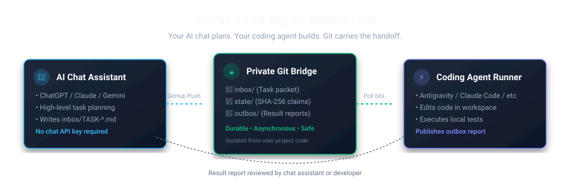
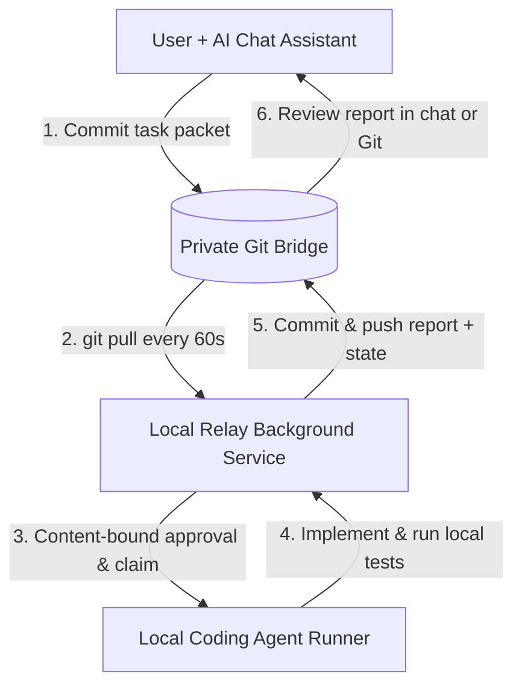
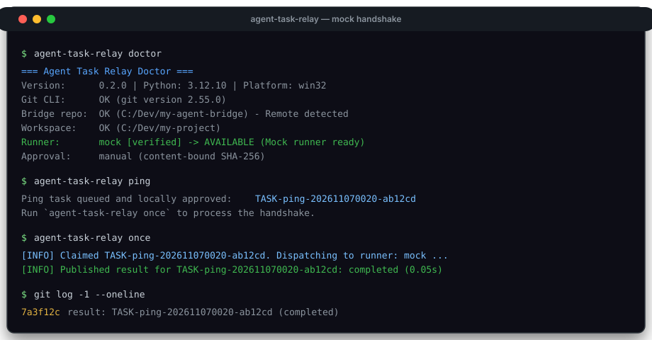

<div align="center">


# Agent Task Relay

**Bridge any AI chat to any coding agent.**

*Your AI chat plans. Your coding agent builds. Agent Task Relay connects them.*

[](https://github.com/egecagintepe/agent-task-relay/actions/workflows/ci.yml)
[](https://www.python.org/downloads/)
[](LICENSE)
[](https://agentskills.io)

Free-to-use, source-available agent skill and local task relay connecting AI chats to coding agents through Git.  
**No copy-paste. No required chat API.**

[Quickstart](#-quickstart-in-5-minutes) · [ChatGPT Setup Guide](#-chatgpt-quickstart) · [Workflow](#-how-it-works) · [Runners](#-supported-runners) · [Security](#-security-first) · [Türkçe Rehber](docs/README.tr.md)

</div>

---

<div align="center">
  
</div>

---

## 🎯 What is Agent Task Relay?

Agent Task Relay allows you to direct software engineering through ordinary conversational AI chats (**ChatGPT**, **Claude**, **Gemini**) while a dedicated local coding agent (**Google Antigravity**, **Claude Code**, or custom CLI agents) performs implementation and tests locally.

### Three Core Benefits

1. **No Repetitive Copy-Pasting:** Chat assistants write structured Markdown tasks directly to a private Git bridge; your local runner picks them up, executes code changes, and commits human-readable reports back to Git.
2. **Zero Relay API Cost:** The relay service requires **no OpenAI, Anthropic, or Gemini API keys**. It operates entirely via Git and Python standard library primitives.
3. **Reuse Existing Accounts:** Leverage your existing chat subscription (ChatGPT Plus/Team/Pro, Claude Pro) and your separately configured coding-agent access without paying for custom multi-agent cloud platforms.

> [!NOTE]
> **Cost & Quota Transparency:** "No required chat API" means you do not need third-party API subscriptions to orchestrate work. However, chat conversations remain subject to your chat provider's message limits, and coding agents consume their own respective model allowances, credits, or API tokens.

---

## ⚖️ Why Not Manual Copy-Paste or Direct API Scripts?

| Feature | Manual Copy-Paste | Direct LLM API Scripts | Agent Task Relay |
| --- | :---: | :---: | :---: |
| **Effort** | High (constant context switching) | Low (fully automated) | **Zero copy-paste handoff** |
| **Relay API Keys Required** | None | Yes (expensive API tokens) | **None (Zero relay tokens)** |
| **Chat Interface Reusability** | High | Low (headless terminal) | **High (Use standard AI chats)** |
| **Audit Trail & History** | None (ephemeral) | Database / custom logs | **Durable Git commits & diffs** |
| **Local Code Isolation** | User-managed | Custom sandbox | **Strict workspace isolation** |
| **Tamper Protection** | N/A | Variable | **Cryptographic SHA-256 bindings** |
| **Secret Redaction** | Manual | Custom | **Automatic secret sanitization** |

---

## 🔄 How It Works



1. **Chat Plans:** You discuss a feature or bug fix with ChatGPT, Claude, or Gemini. The assistant composes a bounded task packet.
2. **Git Carries:** The packet is committed to `inbox/TASK-xxx.md` in your private bridge repository.
3. **Relay Validates & Claims:** The local background service pulls the bridge, verifies content integrity (SHA-256), records approval, and claims the task.
4. **Agent Builds:** The configured coding agent executes inside your workspace, modifies code, and runs tests.
5. **Relay Publishes:** The relay scrubs secrets, records duration and test results, and commits `outbox/TASK-xxx.result.md` back to Git.
6. **Chat Reviews:** You or your assistant inspect the report and decide on the next step.

---

## 🚀 Quickstart in 5 Minutes

### 1. Create a Private Bridge Repository
Create a new **Private** repository on GitHub (e.g. `my-agent-bridge`) and clone it locally:
```bash
git clone git@github.com:<YOUR_USERNAME>/my-agent-bridge.git C:/Dev/my-agent-bridge
```

> [!IMPORTANT]
> Keep your task bridge repository **private** and strictly isolated from your code repository. Real tasks and reports should never be committed to a public repository.

### 2. Install Agent Task Relay
Install directly from the GitHub repository:
```bash
pip install git+https://github.com/egecagintepe/agent-task-relay.git
```
Or clone and install locally:
```bash
git clone https://github.com/egecagintepe/agent-task-relay.git
cd agent-task-relay
pip install .
```

### 3. Initialize Your Project Workspace
Inside your existing software project:
```bash
cd C:/Dev/my-project
agent-task-relay init --workspace C:/Dev/my-project --bridge C:/Dev/my-agent-bridge --runner mock
```

### 4. Verify System Readiness (Doctor)
```bash
agent-task-relay doctor
```

### 5. Execute Zero-Token Mock Handshake
Test the entire pipeline with a deterministic, zero-token test:
```bash
agent-task-relay ping
agent-task-relay once
```
Check `C:/Dev/my-agent-bridge/outbox/` for the completed handshake report!

<div align="center">
  
</div>

---

## 💬 ChatGPT Quickstart

ChatGPT is our primary onboarding companion. Follow these steps to connect ChatGPT to your private bridge:

### Step 1: Connect Your Private Bridge
If your ChatGPT subscription supports the GitHub connector, authorize access to your private bridge repository (`<YOUR_USERNAME>/my-agent-bridge`).

### Step 2: Prime ChatGPT with the Relay Protocol
Copy and paste this initial configuration prompt into ChatGPT:

````markdown
I am using the **Agent Task Relay** protocol to hand off coding tasks to my local coding agent via a private GitHub repository.

Protocol:
- Repository target: `<YOUR_USERNAME>/<YOUR_PRIVATE_BRIDGE_REPO>`
- Task packets must be placed under `inbox/TASK-<unique-id>.md`.
- Task packets must include: Objective, Context, Scope, Acceptance Criteria, Validation, and Safety Constraints.
- Results appear in `outbox/TASK-<unique-id>.result.md` and state in `state/TASK-<unique-id>.json`.

Your Role:
1. Turn my development requests into single, bounded task packets (30–60 minutes of focused engineering).
2. If you have authorized **write access** to my private repository, commit the file to `inbox/` and confirm the write.
3. If you have **read-only access** or no connector, output the complete ready-to-save Markdown file so I can commit it manually.
4. When I say "Review results", read the latest outbox report and assess whether tests and code diffs satisfy the acceptance criteria.
5. Never ask the coding agent to deploy, rotate secrets, or perform destructive operations.

Confirm you understand by listing my bridge repository folders (`inbox/`, `state/`, `outbox/`).
````

### Provider-Neutral Alternative (Claude / Gemini)
For Claude or Gemini, see the ready-to-use prompts in [`prompts/chat/`](prompts/chat/):
- [Initial Configuration](prompts/chat/01_initial_configuration.md)
- [GitHub Connection Validation](prompts/chat/02_github_connection_validation.md)
- [First Hello-World Handshake](prompts/chat/03_first_hello_world_task.md)
- [Large Development Task](prompts/chat/04_large_development_task.md)
- [Bug Fix Request](prompts/chat/05_bug_fix.md)
- [Code Review Request](prompts/chat/06_code_review.md)
- [Result Inspection](prompts/chat/09_result_inspection.md)

---

## 🎛️ Four Supported Operation Modes

- **Mode A — Interactive Chat (Recommended Default):** You brainstorm and plan with your AI assistant in chat. The assistant commits tasks to `inbox/`. The local relay runs them. You ask the assistant to review the returned outbox report.
- **Mode B — Scheduled Chat Checks:** If your chat platform supports scheduled tasks (e.g. ChatGPT scheduled tasks, minimum 1-hour interval), the assistant periodically checks `outbox/` and summarizes completed tasks.
- **Mode C — Local Autonomous Execution:** The local watcher processes explicitly approved task packets continuously in the background without needing re-confirmation from the chat assistant.
- **Mode D — Manual Fallback:** If your chat provider lacks a GitHub connector or has read-only access, it outputs the task Markdown in chat; you save the file to `inbox/` manually without losing any automation benefits.

---

## 🏃 Supported Runners

Agent Task Relay decouples task transport from coding agent execution. Multiple runners are supported across three tiers:

| Runner | ID | Support Tier | Verification Status | Command Invocation |
| --- | --- | --- | --- | --- |
| **Mock Runner** | `mock` | **Verified** | Verified Live (Zero Tokens) | Deterministic internal Python logic |
| **Custom Command** | `custom` | **Verified** | Verified Live (Subprocess) | Configured allowlist array & timeout |
| **Google Antigravity** | `agy` | **Experimental** | Tested with realistic stub binary | `agy -p <prompt> --output-format json` |
| **Anthropic Claude Code** | `claude` | **Experimental** | Documented CLI specification | `claude -p <prompt>` |
| **Google Gemini CLI** | `gemini` | **Experimental** | Documented CLI specification | `gemini -p <prompt>` |
| **OpenAI Codex CLI** | `codex` | **Contract** | Documented contract interface | `codex exec <prompt>` |
| **OpenCode** | `opencode` | **Contract** | Documented contract interface | `opencode run <prompt>` |
| **Local Agent Harness** | `local` | **Contract** | Documented contract interface | External agent wrapper with filesystem & tools |

> [!IMPORTANT]
> **A local LLM is not an agent:** A raw local model endpoint (such as bare `ollama run mistral`) is a text generator, not a coding agent. It requires an agent harness capable of reading files, modifying code, and using permitted tools.

To switch runners:
```bash
agent-task-relay config --runner agy --approval manual
```

---

## 📦 Agent Skill Installation

Agent Task Relay is packaged as an [Agent Skills](https://agentskills.io)-compliant skill.

To install into compatible agents:
```bash
npx skills add egecagintepe/agent-task-relay --skill agent-task-relay
```

Or manually copy `skills/agent-task-relay/` into your agent's skills directory (e.g., `.agents/skills/agent-task-relay/`).

---

## ⚙️ Background Service Lifecycle

Keep the relay polling quietly in the background without keeping a terminal open:

```bash
# Start background service
agent-task-relay start

# Check live service status & task queue
agent-task-relay status

# View local service logs
agent-task-relay logs

# Stop service
agent-task-relay stop

# Restart service
agent-task-relay restart
```

### OS Autostart Definitions
Generate system service definitions to launch the relay automatically on boot or login:
```bash
# Windows Task Scheduler:
agent-task-relay service-install --os windows

# Linux systemd user unit:
agent-task-relay service-install --os linux

# macOS launchd plist:
agent-task-relay service-install --os macos
```

---

## 📂 Repository & Bridge Structure

```text
# 1. Your Software Project (Workspace)
my-project/
├── .agent-task-relay/
│   ├── config.json         # Local configuration (ignored by Git)
│   ├── approved.json       # SHA-256 bound approvals
│   ├── run.lock            # Process concurrency lock
│   └── logs/               # Raw agent stdout/stderr logs
├── .agents/skills/
│   └── agent-task-relay/   # Installed Agent Skill
└── src/                    # Your application codebase

# 2. Your Private Bridge (Task Queue)
my-agent-bridge/
├── inbox/                  # Inbound task packets (TASK-0001.md)
├── state/                  # State records (TASK-0001.json)
├── outbox/                 # Result reports (TASK-0001.result.md)
└── archive/                # Processed tasks
```

---

## 🛡️ Security First

- **Untrusted Remote Input:** All Markdown tasks from Git are treated as untrusted input. Commands are never constructed with `shell=True`.
- **Content-Bound Approvals:** Approvals are cryptographically tied to the SHA-256 hash of the task file. Editing a task after approval immediately revokes approval.
- **Directory Traversal Defense:** All filenames are strictly regex-validated; symlinks and directory navigation (`..`, `/`, `\`) are blocked.
- **Automatic Secret Redaction:** Reports published back to Git are automatically scrubbed of API keys, GitHub tokens, AWS keys, Slack tokens, private keys, and passwords.
- **No Silent Re-execution:** If a runner crashes while executing a claimed task, the relay refuses to re-execute it automatically, preventing corrupting partial changes.
- **Human Escalation:** High-risk operations (production deployment, credential rotation, destructive database operations) require separate human authorization.

Read our complete [Security Policy & Threat Model](SECURITY.md).

---

## 📖 Detailed Documentation

- [Getting Started Guide](docs/getting-started.md) — Step-by-step onboarding walkthrough
- [System Architecture](docs/architecture.md) — State machine, transport details, and data models
- [Configuration Reference](docs/configuration.md) — Configuration options and examples
- [Provider Capability Matrix](docs/providers.md) — Detailed chat and runner compatibility analysis
- [Scheduling & Automation Guide](docs/scheduling.md) — ChatGPT scheduling limits vs local polling
- [Troubleshooting & Diagnostics](docs/troubleshooting.md) — Common error recovery workflows
- [Türkçe Başlangıç Rehberi](docs/README.tr.md) — Türkçe kurulum ve kullanım rehberi

---

## 🤝 Project Governance & Usage Policy

**Agent Task Relay** is a free-to-use, source-available developer tool created, copyrighted, and maintained by **Ege Çağın Tepe** ([@egecagintepe](https://github.com/egecagintepe)).

- **Permitted Usage:** You are free to download, install, run, and privately modify this software for personal or internal business workflows under the [PolyForm Internal Use License 1.0.0](LICENSE).
- **Redistribution Prohibited:** Unauthorized redistribution, repackaging, rebranding, sublicensing, or resale is strictly prohibited.
- **Contributions & Pull Requests:** This repository does not accept external pull requests or code contributions. Pull requests may be disabled in repository settings. Bug reports and adapter feedback may be submitted via [GitHub Issues](https://github.com/egecagintepe/agent-task-relay/issues).

---

## 📄 License

Licensed under the **PolyForm Internal Use License 1.0.0**. See the [LICENSE](LICENSE) file for complete legal terms.
Copyright 2026 Ege Çağın Tepe. All rights reserved.
