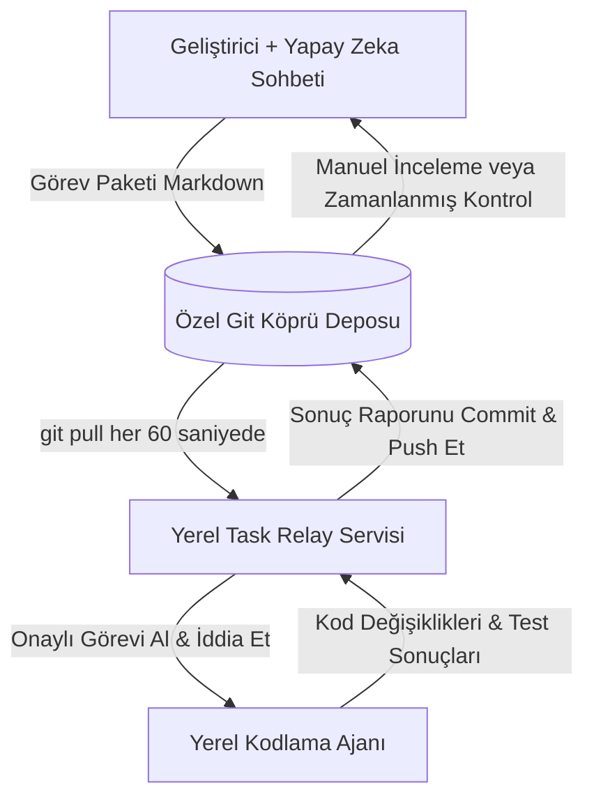

<div align="center">

# 📬 Agent Task Relay

**Yapay zeka sohbetiniz planlar. Kodlama ajanınız inşa eder. Agent Task Relay onları bağlar.**

Git tabanlı, satıcıdan bağımsız, ücretsiz ve kaynak kodu erişilebilir (source-available) ajan yeteneği (Agent Skill) ve yerel görev aktarıcısı.  
Kopyala-yapıştır zahmeti yok. Relay için zorunlu sohbet API'si yok.

[Hızlı Başlangıç](#hızlı-başlangıç) · [Çalışma Modları](#dört-çalışma-modu) · [Desteklenen Ajanlar](#desteklenen-ajanlar) · [Güvenlik](#güvenlik-ve-gizlilik) · [English README](../README.md)

</div>

---

## Neden Agent Task Relay?

Yazılım mimarisini ChatGPT, Claude veya Gemini gibi güçlü bir sohbet modeliyle planlayabilir, ancak talimatları bir CLI kodlama ajanına manuel olarak kopyalayıp çıkan sonuçları tekrar sohbete yapıştırmak zorunda kalırsınız. 

Agent Task Relay, **özel bir Git deposunu görev gelen kutusu (`inbox/`) ve rapor giden kutusu (`outbox/`) olarak kullanarak** bu süreci otomatikleştirir:

1. **Kopyala-Yapıştır Döngüsüne Son:** Sohbetiniz görev paketini Git'e yazar; yerel servis algılar, kodlama ajanı çalıştırır ve raporu Git'e geri gönderir.
2. **Relay İçin Ek LLM API'si Gerekmez:** Aktarıcı tamamen Python standart kütüphanesi ve Git üzerinden çalışır; aracı bir bulut sunucusu veya fazladan API ücreti talep etmez.
3. **Mevcut Abonelikleri Değerlendirin:** Halihazırda kullandığınız ChatGPT/Claude sohbetinizi ve yerel CLI kodlama ajanı erişiminizi bir araya getirir.

> [!NOTE]
> **Maliyet ve Kota Şeffaflığı:** "Relay için API gerekmez" demek sınırsız veya bedava yapay zeka anlamına gelmez. Sohbet sağlayıcınız ve yerel kodlama ajanınız kendi kullanım sınırları, abonelikleri veya API kredileri dahilinde çalışmaya devam eder.

---

## Mimari ve İş Akışı



---

## Dört Çalışma Modu

- **Mod A — Etkileşimli Sohbet (Önerilen):** Sohbetinizle konuşup görevi hazırlarsınız. Sohbet görevi özel depoya gönderir. Yerel relay çalıştırır; sonucu incelemesi için sohbete tek bir komut verirsiniz.
- **Mod B — Zamanlanmış Sohbet Kontrolleri:** ChatGPT gibi platformların zamanlanmış görevleri (saatlik minimum periyot) yeni tamamlanan raporları otomatik inceleyebilir.
- **Mod C — Yerel Otonom Yürütme:** Açıkça onaylanmış görevler, sohbetle yeniden konuşmaya gerek kalmadan sırayla yerel ajan tarafından işlenir.
- **Mod D — Manuel Yedek:** Sohbetinizin GitHub yazma izni yoksa görev metnini sohbette üretir, siz tek tıkla depoya yapıştırırsınız.

---

## Hızlı Başlangıç

### 1. Özel Bir Git Köprü Deposu Oluşturun
GitHub'da **özel (Private)** bir repo açın (örn. `ajans-koprusu`) ve yerel bilgisayarınıza klonlayın:
```bash
git clone git@github.com:kullanici/ajans-koprusu.git C:/Dev/ajans-koprusu
```

### 2. Kurulum
Doğrudan GitHub deposundan kurun:
```bash
pip install git+https://github.com/egecagintepe/agent-task-relay.git
```
Veya depoyu klonlayıp yerel kurun:
```bash
git clone https://github.com/egecagintepe/agent-task-relay.git
cd agent-task-relay
pip install .
```

### 3. Projenizi ve Köprüyü Başlatın
Yazılım projenizin dizininde (`C:/Dev/benim-projem`):
```bash
agent-task-relay init --workspace C:/Dev/benim-projem --bridge C:/Dev/ajans-koprusu --runner mock
```

### 4. Sağlık Denetimi (Doctor)
```bash
agent-task-relay doctor
```

### 5. Sıfır Tokenlı Mock Doğrulama
```bash
agent-task-relay ping
agent-task-relay once
```
`C:/Dev/ajans-koprusu/outbox/` klasöründeki sonuç raporunu inceleyin!

### 6. Kodlama Ajanını Yapılandırın
```bash
# Google Antigravity CLI için:
agent-task-relay config --runner agy --approval manual

# Anthropic Claude Code için:
agent-task-relay config --runner claude --approval manual
```

### 7. Arka Plan Servisini Başlatın
```bash
agent-task-relay start
agent-task-relay status
```

---

## Güvenlik ve Gizlilik

- **Uzaktan Gelen Markdown Güvenilmezdir:** Özel depodan gelse bile görevler komut enjeksiyonuna karşı filtrelenir; hiçbir zaman `shell=True` kullanılmaz.
- **SHA-256 Kriptografik Onay:** Bir görevi onayladıktan sonra dosya değiştirilirse onay geçersiz kılınır ve görev çalıştırılmaz.
- **Sır Temizleme (Redaction):** API anahtarları, GitHub tokenları, şifreler ve özel anahtarlar outbox raporuna yazılmadan önce otomatik temizlenir.
- **İzin İhlallerini Durdurma:** Hiçbir görev dosyası kendi kendine üretim sunucusuna dağıtım (deploy), veritabanı silme veya yetki yükseltme izni veremez.

---

## 🤝 Proje Yönetimi ve Lisans

**Agent Task Relay**, **Ege Çağın Tepe** ([@egecagintepe](https://github.com/egecagintepe)) tarafından geliştirilmiş ve telif hakları saklı tutulan, ücretsiz kullanıma açık kaynak erişimli (source-available) bir geliştirici aracıdır.

- **İzin Verilen Kullanım:** Yazılımı kişisel veya kurum içi operasyonlarınız için ücretsiz olarak indirebilir, kurabilir, çalıştırabilir ve özel olarak değiştirebilirsiniz ([PolyForm Internal Use License 1.0.0](../LICENSE)).
- **Yeniden Dağıtım Yasağı:** Yazılımın üçüncü taraflara yetkisiz olarak yeniden dağıtılması, paketlenmesi, satılması veya ticari bir hizmet olarak barındırılması yasaktır.
- **Katkılar ve Pull Request'ler:** Depo harici kod katkılarına veya genel Pull Request'lere kapalıdır. Hata bildirimleri ve geri bildirimler GitHub Issues üzerinden iletilebilir.
